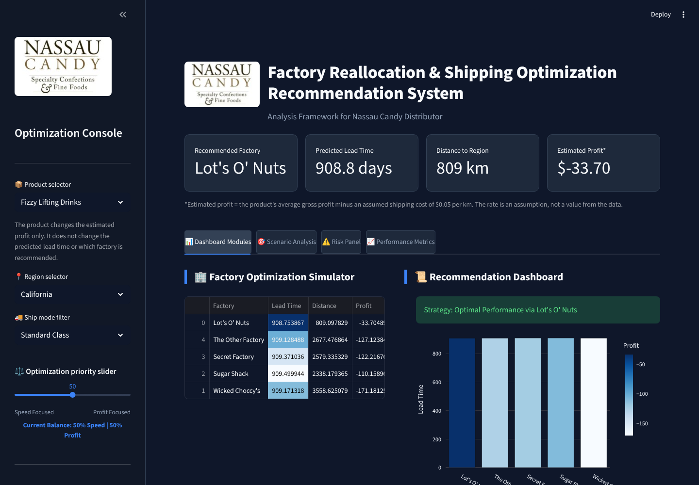

# Nassau Candy — Factory Reallocation & Shipping Optimizer

**Live app:** https://bfjnnszxrmj7s5lbkgaqr2.streamlit.app/

A Streamlit decision tool that recommends which of Nassau Candy Distributor's five factories should serve a product and customer region. It balances predicted delivery time against estimated shipping cost.

Built during my Data Analyst Internship at Unified Mentor (2026).




## The business question

Nassau Candy ships from five factories using fixed rules. Would choosing a different factory for a product and region make delivery faster, or protect profit?

## Key findings

- **Ship mode drives delivery time, not distance.** Same Day orders arrive about 5 days sooner than Standard Class on average. Distance and lead time have almost no link (correlation **0.015** across 1,993 orders).
- **Moving production closer is a cost decision, not a speed decision.** A nearer factory lowers estimated shipping cost but does not measurably shorten delivery.
- **A simple rule matches the model.** Predicting the average lead time for each ship mode (MAE 0.82 days) does as well as the Random Forest (MAE 0.87 days). I report both, because the comparison is the honest result.

## How it works

1. You choose a product, a destination region, a ship mode, and a speed-vs-profit slider.
2. For each of the five factories, the app:
   - calculates the distance to the region with the **haversine formula**
   - predicts lead time with a **Random Forest** model
   - estimates profit as the product's average gross profit minus an **assumed $0.05 per km** shipping cost
3. Lead time and profit are scaled to 0–1 (min-max scaling) and combined using the slider weight.
4. The factory with the best combined score is recommended.

The app has four tabs: a factory ranking, a what-if map, a risk panel, and model diagnostics.

## Model performance

Tested on a held-out 20% of orders (399 orders). Full code in [`train_model.ipynb`](train_model.ipynb).

| Model | MAE (days) | RMSE (days) | R² |
|---|---|---|---|
| Baseline: overall average | 1.33 | 1.74 | 0.00 |
| Baseline: average per ship mode | 0.82 | 1.02 | 0.66 |
| Linear Regression | 0.84 | 1.02 | 0.66 |
| Gradient Boosting | 0.85 | 1.03 | 0.65 |
| **Random Forest (used in app)** | **0.87** | **1.11** | **0.59** |

## Limitations

- **Ship dates look artificial.** Orders are from 2024, but ship dates fall in 2026–27, so lead times are about 908 days. Only the differences between orders (a few days) are meaningful.
- **The shipping cost rate is an assumption.** $0.05 per km is not from real freight data. At that rate most routes show a negative estimated profit.
- **The product does not change the recommendation.** It only changes the profit figure.
- **Limited coverage.** The app offers 8 regions, and two factories have very few orders (Sugar Shack 6, The Other Factory 24).

## Run it locally

```bash
git clone https://github.com/Vipsa2207/Nassau-Candy-Supply-Chain-Optimizer.git
cd Nassau-Candy-Supply-Chain-Optimizer
pip install -r requirements.txt
streamlit run app.py
```

To retrain the model, run `train_model.ipynb`. It rewrites `candy_model.pkl` and `model_columns.pkl`.

## Project files

| File | What it is |
|---|---|
| `app.py` | The Streamlit app |
| `train_model.ipynb` | Model training and evaluation |
| `cleaned_candy_data.csv` | Order data with factory and customer coordinates |
| `candy_model.pkl`, `model_columns.pkl` | The trained model and its input columns |

## Research paper

I authored a research paper on this project (JETIR paper ID 581046, accepted, not published). A revised version will be added to this repository.

## How I built it

I used AI to help write the Python code. I framed the business question, validated the outputs against the data, tested the model against baselines, and wrote the findings.

## Author

**Vipsa Patel** — Data Analyst Intern, Unified Mentor · [LinkedIn](https://www.linkedin.com/in/vipsapatel)
